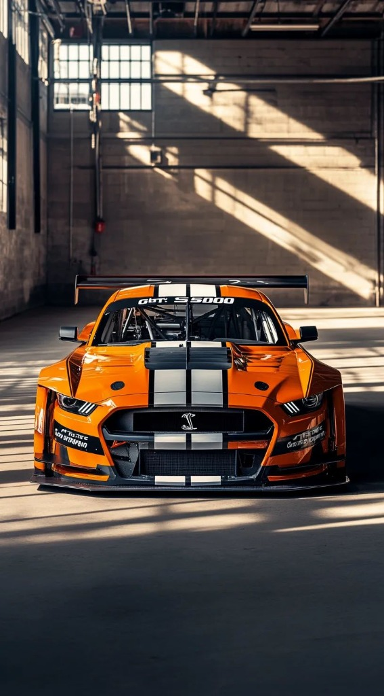

# N8-LIGHTNING: 3D Arcade Racing Game



> **High-Octane Browser & Mobile 3D Arcade Racing Game Inspired by Asphalt 8**  
> Built with Three.js, React, WebGL, custom arcade physics, nitro boost, drift dynamics, and cross-platform Android APK support.

[](https://github.com/hardikkaurani/N8-Lightning/actions)
[](https://opensource.org/licenses/MIT)
[](https://www.typescriptlang.org/)
[](https://threejs.org/)

---

## 🏎️ Overview

**N8-LIGHTNING** is a full-featured, high-performance 3D arcade racing game engineered to capture the speed, adrenaline, and visual spectacle of arcade classics like *Asphalt 8*. 

Every race mode leads to a genuine 3D playable simulation powered by a custom fixed-timestep physics engine, procedural 3D tracks, AI opponents, procedural vehicle generators, and zero-latency Web Audio API sound synthesis.

---

## 🌟 Key Features

### 1. Arcade Vehicle Physics & Handling
- **Progressive Torque Curve**: Non-linear acceleration curve with dynamic speed resistance and gear-shifting simulation.
- **Speed-Dependent Steering**: High-speed stability prevents snap-oversteer while allowing rapid turn-in at cornering speeds.
- **Drift Mechanics**: Holding `Space` or the on-screen Drift button reduces lateral tire grip, initiating high-angle powerslides, tire smoke trails, and accumulating drift points.
- **Multi-Stage Nitro System**: Activating Nitro engages a 2.2x acceleration boost, +25% top speed overspeed, dynamic camera FOV warp, and dual flame exhaust jets.
- **Airborne Jump Ramps**: Strategically placed track ramps launch vehicles airborne with gravity and pitch/roll auto-stabilization for perfect landings.
- **Barrier & Vehicle Collisions**: Bouncy elastic barrier impulses, speed scrubs, collision sparks, and an instantaneous vehicle reset (`R` key).

### 2. Four Original Playable Circuits
1. **Neon City Circuit (3.2 km)**: Cyberpunk metropolis at night with skyscrapers, holographic billboards, and glowing highway flyover ramps.
2. **Desert Storm Canyon (3.8 km)**: Sun-drenched sandstone mesas, canyon curves, and sweeping desert drift sections.
3. **Alpine Rush Pass (3.5 km)**: High-altitude snowy mountain pass with tight hairpins, icy bridges, and cliffside guardrails.
4. **Coastline X Grand Prix (3.4 km)**: Ocean highway across grand suspension bridges, seaside cliffs, and high-speed coastal sweeps.

### 3. Six Configurable 3D Vehicles
- **Apex GT-500 (Street Muscle)**: Roaring supercharged V8 with high-impact race orange livery and dual white racing stripes.
- **Venom Cyber-R (Sport Coupe)**: Twin-turbo AWD precision machine in cobalt blue.
- **Drift King RS (Widebody Tuner)**: Acid neon green street tuner engineered for extreme drift angles.
- **Spectre Phantom (Supercar)**: Mid-engine V10 supercar in satin midnight carbon with violet neon underglow.
- **Thunderbolt Prime (Nitro Prototype)**: Aerospace hyper-prototype with rocket thrusters and rapid nitro regeneration.
- **Valkyrie Hyper-X (Hypercar)**: Quad-turbo Le Mans hypercar reaching 380+ km/h.

### 4. Career Mode & Championship Campaign
- **3 Progressive Chapters**: *Chapter 1: Street Awakening*, *Chapter 2: Pro Circuit Challenge*, and *Chapter 3: Apex Legends Championship*.
- **12 Unlockable Race Events**: 3-star objectives per event (e.g. Finish 1st, Drift 1,500m, Beat Target Time), star requirements, cash purses, and XP rewards.

### 5. 3D Interactive Garage & Tuning
- 360-degree turntable showroom with drag rotation and studio lighting reflections.
- 4 Performance upgrade tiers: Top Speed, Acceleration, Handling, and Nitro Efficiency.
- Metallic paint booth: Custom body paints and racing stripe liveries.

### 6. Synthesized Web Audio Design
- 100% self-contained Web Audio API synthesizer (no external audio assets that can fail).
- RPM-dependent engine audio pitch modulation.
- Bandpass-filtered turbo nitro rush and white-noise tire screeching.
- Electronic synth background beats, collision thuds, checkpoint chimes, and countdown tones.

### 7. Dual Desktop & Mobile Controls
- Desktop keyboard controls (`W/A/S/D` or Arrow keys, `Space` for Drift, `Shift` for Nitro, `R` for Reset, `Esc` for Pause).
- Responsive on-screen touch controls with multi-touch pointer events and anti-scroll prevention.

---

## 🎮 Controls

| Action | Desktop Keyboard | Mobile Touch Control |
| :--- | :--- | :--- |
| **Accelerate** | `W` or `Arrow Up` | Right "GAS" Pedal |
| **Brake / Reverse** | `S` or `Arrow Down` | Left "BRAKE" Pedal |
| **Steer Left** | `A` or `Arrow Left` | Left Arrow Button |
| **Steer Right** | `D` or `Arrow Right` | Right Arrow Button |
| **Drift / Handbrake** | `Space` | "DRIFT" Button |
| **Nitro Boost** | `Shift` | "NITRO" Button |
| **Reset Vehicle** | `R` | Reset Icon Button |
| **Pause Game** | `Escape` or `P` | Pause Icon Button |

---

## 🛠️ Technology Stack

- **Frontend**: React 19, TypeScript, Vite, Tailwind CSS v4, Lucide React, Canvas Confetti
- **3D Graphics Engine**: Three.js, WebGL PCF Soft Shadow Mapping, ACES Filmic Tone Mapping
- **Mobile Packaging**: Capacitor Android (`@capacitor/android`)
- **Testing**: Vitest automated unit testing
- **Deployment**: Vercel & GitHub Pages

---

## 🚀 Local Development Setup

### Prerequisites
- Node.js (v18 or higher)
- npm (v9 or higher)

### Installation
```bash
# Clone the repository
git clone https://github.com/hardikkaurani/N8-Lightning.git
cd N8-Lightning

# Install dependencies
npm install

# Start local development server
npm run dev
```
Open [http://localhost:3000](http://localhost:3000) in your browser.

---

## 🧪 Automated Testing

Run the test suite:
```bash
# Run unit tests with Vitest
npm test

# Run build typecheck and bundle verification
npm run build
```

---

## 📱 Android APK Build

To build an Android APK locally using Capacitor:
```bash
# Build web production bundle
npm run build

# Sync web assets to Android platform
npx cap sync android

# Build debug APK using Gradle
cd android
./gradlew assembleDebug
```
The compiled APK will be located at:
`android/app/build/outputs/apk/debug/app-debug.apk`

---

## 📄 License

This project is licensed under the MIT License. All vehicle models, tracks, shaders, and audio synthesizers are original procedural implementations.
