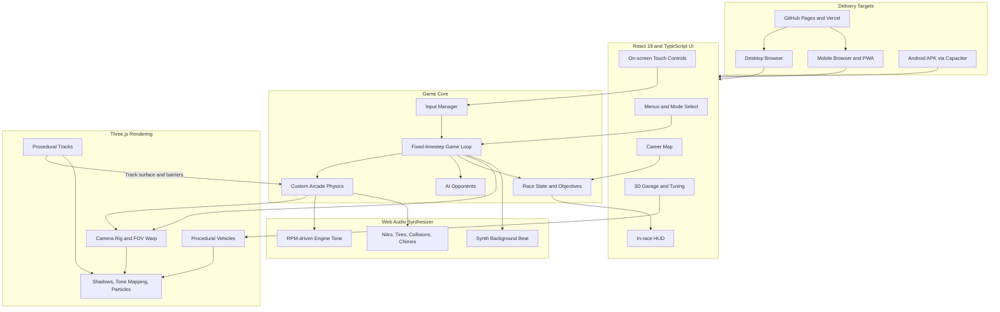
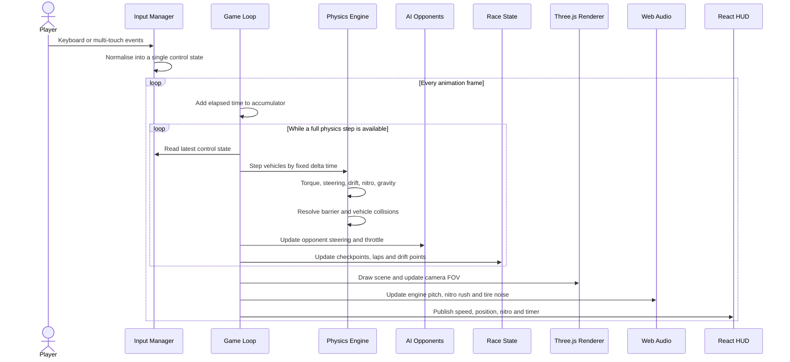
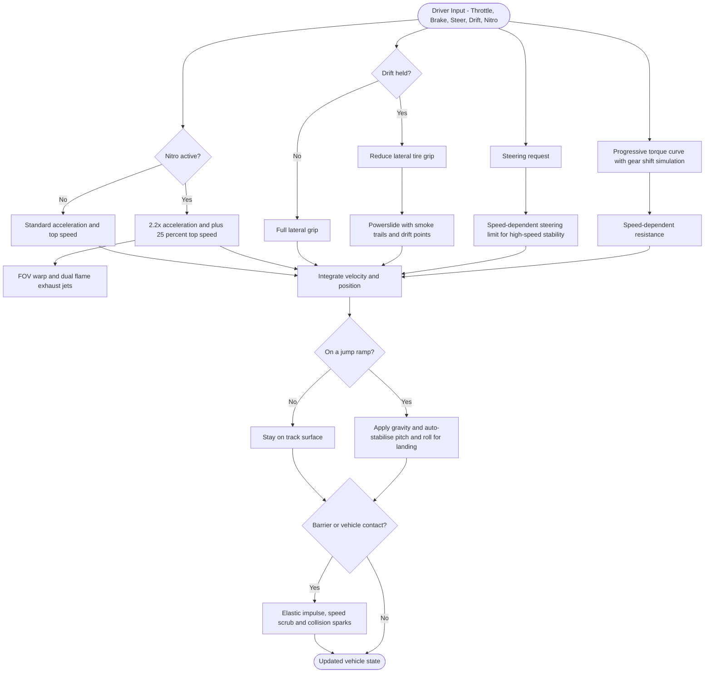
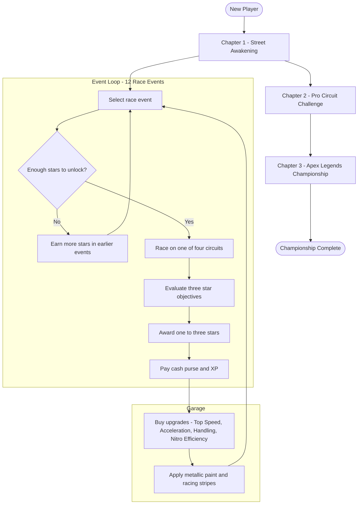

<div align="center">


<h1>N8-LIGHTNING</h1>

<p><strong>A high-octane 3D arcade racing game for browser and Android, inspired by Asphalt 8.<br/>
Custom fixed-timestep physics, drift and nitro mechanics, procedural tracks and vehicles,<br/>
and a fully synthesized Web Audio soundtrack. No external game assets required.</strong></p>


<a href="https://github.com/hardikkaurani/N8-Lightning/actions"></a>


<a href="https://opensource.org/licenses/MIT"></a>

<br/><br/>

</div>

---

## Play and Download

| Platform | Link | Notes |
|---|---|---|
| Browser (desktop and mobile) | [hardikkaurani.github.io/N8-Lightning](https://hardikkaurani.github.io/N8-Lightning/) | No install needed. Keyboard on desktop, touch controls on mobile |
| Android | [releases folder](https://github.com/hardikkaurani/N8-Lightning/tree/main/releases) | Packaged build produced with Capacitor |
| Source code | [github.com/hardikkaurani/N8-Lightning](https://github.com/hardikkaurani/N8-Lightning) | MIT licensed |

---

## Table of Contents

- [Overview](#overview)
- [Engineering Highlights](#engineering-highlights)
- [System Architecture](#system-architecture)
- [Frame Lifecycle](#frame-lifecycle)
- [Vehicle Dynamics Model](#vehicle-dynamics-model)
- [Career and Garage Progression](#career-and-garage-progression)
- [Game Content](#game-content)
- [Controls](#controls)
- [Technology Stack](#technology-stack)
- [Project Structure](#project-structure)
- [Getting Started](#getting-started)
- [Automated Testing](#automated-testing)
- [Android APK Build](#android-apk-build)
- [Deployment](#deployment)
- [License](#license)

---

## Overview

N8-LIGHTNING is a complete 3D arcade racing game that runs in the browser and ships as an Android app from the same codebase. Every race mode leads to a genuinely playable 3D simulation powered by a custom fixed-timestep physics engine, procedural 3D tracks, AI opponents, procedural vehicle generators, and zero-latency Web Audio API sound synthesis.

The goal of the project is to capture the speed and visual spectacle of arcade classics while staying fully self-contained. Vehicles, circuits, shaders, and audio are all generated in code, so there are no external model, texture, or sound files that can fail to load.

Key design decisions:

- **Fixed-timestep physics**: Vehicle simulation advances in constant time steps, decoupled from the rendering frame rate, so handling feels the same on a 60 Hz laptop and a high-refresh phone.
- **Procedural content**: Tracks and vehicles are produced by generators rather than imported assets, which keeps the bundle small and makes new content a matter of configuration.
- **Synthesized audio**: Engine tone, nitro rush, tire screech, collisions, and background beats come from the Web Audio API, so the game works offline with no audio downloads.
- **One codebase, three targets**: The same React and Three.js application runs on desktop browsers, mobile browsers, and Android through Capacitor.
- **Input parity**: Keyboard and multi-touch pointer input feed the same control state, so desktop and mobile players get identical vehicle behaviour.

---

## Engineering Highlights

| Area | Approach | Why it matters |
|---|---|---|
| Physics | Custom arcade engine with progressive torque curve, speed-dependent steering, drift grip model, and collision impulses | Handling is tuned for fun and predictability rather than constrained by a general-purpose physics library |
| Rendering | Three.js with PCF soft shadow mapping and ACES filmic tone mapping | Cinematic look at playable frame rates on WebGL |
| Content generation | Procedural tracks and vehicle generators | Four circuits and six vehicles with no asset pipeline |
| Audio | Self-contained Web Audio synthesizer with RPM-dependent engine pitch | Works offline, no asset loading failures |
| Input | Keyboard plus multi-touch pointer events with anti-scroll prevention | Same game, same controls logic on desktop and phone |
| Packaging | Capacitor Android project, deploy workflow for GitHub Pages and Vercel | Browser and APK builds from one repository |
| Quality | TypeScript across the project, Vitest unit tests, typechecked production build, Oxlint configuration | Regressions are caught before a build ships |

---

## System Architecture

The full component layout of N8-LIGHTNING, from delivery targets through the React UI, game core, Three.js rendering, and the Web Audio synthesizer.



---

## Frame Lifecycle

What happens on every animation frame. Physics advances in fixed steps using an accumulator, while rendering, audio, and the HUD update once per frame.



---

## Vehicle Dynamics Model

How driver input becomes vehicle motion. Throttle, steering, drift, and nitro each follow their own path, then merge into a single integration step before ramps and collisions are resolved.



---

## Career and Garage Progression

The long-term loop of the game. Players race events to earn stars, cash, and XP, spend cash in the garage, and use better cars to unlock the next chapter.



---

## Game Content

### Circuits

| Circuit | Length | Setting |
|---|---|---|
| Neon City Circuit | 3.2 km | Cyberpunk metropolis at night with skyscrapers, holographic billboards, and glowing highway flyover ramps |
| Desert Storm Canyon | 3.8 km | Sun-drenched sandstone mesas, canyon curves, and sweeping desert drift sections |
| Alpine Rush Pass | 3.5 km | High-altitude snowy mountain pass with tight hairpins, icy bridges, and cliffside guardrails |
| Coastline X Grand Prix | 3.4 km | Ocean highway across grand suspension bridges, seaside cliffs, and high-speed coastal sweeps |

### Vehicles

| Vehicle | Class | Character |
|---|---|---|
| Apex GT-500 | Street Muscle | Supercharged V8 in race orange with dual white racing stripes |
| Venom Cyber-R | Sport Coupe | Twin-turbo AWD precision machine in cobalt blue |
| Drift King RS | Widebody Tuner | Acid neon green street tuner built for extreme drift angles |
| Spectre Phantom | Supercar | Mid-engine V10 in satin midnight carbon with violet neon underglow |
| Thunderbolt Prime | Nitro Prototype | Aerospace hyper-prototype with rocket thrusters and rapid nitro regeneration |
| Valkyrie Hyper-X | Hypercar | Quad-turbo Le Mans hypercar reaching 380+ km/h |

### Career Mode

- **Three chapters**: Street Awakening, Pro Circuit Challenge, and Apex Legends Championship
- **Twelve unlockable race events**, each with three-star objectives such as finishing first, drifting 1,500 m, or beating a target time
- **Star requirements, cash purses, and XP rewards** gate progress and feed the garage

### Garage and Tuning

- 360-degree turntable showroom with drag rotation and studio lighting reflections
- Four performance upgrade tiers: Top Speed, Acceleration, Handling, and Nitro Efficiency
- Metallic paint booth with custom body paints and racing stripe liveries

### Audio Design

- 100% self-contained Web Audio API synthesizer, with no external audio assets that can fail to load
- RPM-dependent engine pitch modulation
- Bandpass-filtered turbo nitro rush and white-noise tire screeching
- Electronic synth background beats, collision thuds, checkpoint chimes, and countdown tones

---

## Controls

| Action | Desktop Keyboard | Mobile Touch |
|:---|:---|:---|
| Accelerate | `W` or `Arrow Up` | Right GAS pedal |
| Brake and reverse | `S` or `Arrow Down` | Left BRAKE pedal |
| Steer left | `A` or `Arrow Left` | Left arrow button |
| Steer right | `D` or `Arrow Right` | Right arrow button |
| Drift and handbrake | `Space` | DRIFT button |
| Nitro boost | `Shift` | NITRO button |
| Reset vehicle | `R` | Reset icon button |
| Pause | `Escape` or `P` | Pause icon button |

---

## Technology Stack

| Layer | Technology | Purpose |
|---|---|---|
| UI | React 19, TypeScript | Menus, HUD, garage, career screens |
| Build tool | Vite | Fast dev server and optimised production bundle |
| Styling | Tailwind CSS v4 | Utility-first styling |
| 3D engine | Three.js, WebGL | Scene rendering, PCF soft shadows, ACES filmic tone mapping |
| Audio | Web Audio API | Synthesized engine, effects, and music |
| Mobile packaging | Capacitor Android | Native Android wrapper around the web build |
| Testing | Vitest | Automated unit tests |
| Linting | Oxlint | Fast static analysis |
| Extras | Lucide React, Canvas Confetti | Icons and celebration effects |
| Deployment | GitHub Pages, Vercel, GitHub Actions | Automated build and hosting |

---

## Project Structure

```
N8-Lightning/
|
+-- .github/
|   +-- workflows/               # CI and deploy pipeline (deploy.yml)
|
+-- android/                     # Capacitor Android project
+-- public/                      # Static assets such as images and logo
+-- releases/                    # Packaged release builds
+-- src/                         # Game, UI, rendering, and audio source
|
+-- capacitor.config.ts          # Capacitor app configuration
+-- index.html                   # Application entry HTML
+-- vite.config.ts               # Vite build configuration
+-- vercel.json                  # Vercel deployment configuration
+-- tsconfig.json                # TypeScript project references
+-- tsconfig.app.json            # TypeScript config for application code
+-- tsconfig.node.json           # TypeScript config for tooling
+-- .oxlintrc.json               # Oxlint rules
+-- package.json
+-- README.md
```

---

## Getting Started

### Prerequisites

| Requirement | Version |
|---|---|
| Node.js | v18 or higher |
| npm | v9 or higher |

### Installation

```bash
# Clone the repository
git clone https://github.com/hardikkaurani/N8-Lightning.git
cd N8-Lightning

# Install dependencies
npm install

# Start the local development server
npm run dev
```

Open [http://localhost:3000](http://localhost:3000) in your browser.

---

## Automated Testing

```bash
# Run unit tests with Vitest
npm test

# Typecheck and verify the production bundle
npm run build
```

---

## Android APK Build

Build an Android APK locally with Capacitor:

```bash
# Build the web production bundle
npm run build

# Sync web assets into the Android platform
npx cap sync android

# Build a debug APK with Gradle
cd android
./gradlew assembleDebug
```

The compiled APK is written to `android/app/build/outputs/apk/debug/app-debug.apk`.

---

## Deployment

The repository includes a GitHub Actions workflow (`deploy.yml`) that builds and publishes the web version on every push to `main`.

| Target | Details |
|---|---|
| GitHub Pages | Live at [hardikkaurani.github.io/N8-Lightning](https://hardikkaurani.github.io/N8-Lightning/) |
| Vercel | Configured through `vercel.json` |
| Android | Built locally with Capacitor and Gradle, see [Android APK Build](#android-apk-build) |

---

## License

This project is licensed under the MIT License. All vehicle models, tracks, shaders, and audio synthesizers are original procedural implementations.

---

<div align="center">


*N8-LIGHTNING. Built for speed.*


</div>
